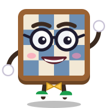

<p align="center">
  
</p>

<h1 align="center">Movemory</h1>

<p align="center">
  <b>Apprenez vos ouvertures d'échecs comme une langue : 5 minutes par jour, sur l'échiquier, avec Memo.</b><br>
  <sub>iOS · Android · Web — open source (GPL-3.0) — en construction 🚧</sub>
</p>

---

## Le principe

Vous connaissez ce moment : votre adversaire joue un coup que vous avez *forcément* déjà vu… et votre préparation
s'est envolée. **Movemory** règle ça avec ce qui marche pour les langues : la **répétition espacée**.

- ♟️ **Vous choisissez vos ouvertures** (ex. la Partie italienne avec les Blancs, la Caro-Kann avec les Noirs).
- 🎯 **Chaque jour, une courte séance** : une position s'affiche, **vous jouez le coup** sur l'échiquier. Pas de QCM.
- 🧠 **Une erreur ? La position revient plus souvent**, jusqu'à ce qu'elle soit acquise. Ce que vous maîtrisez revient de plus en plus rarement, juste assez pour ne pas l'oublier.
- 💬 **Memo explique chaque coup** : pas seulement *quoi* jouer, mais *pourquoi* (le centre, le développement, la case faible f7…).
- ⚔️ **Des coups à punir** : l'adversaire commet une imprécision, à vous de trouver comment en profiter. On réfléchit, on ne récite pas.

## Des mondes, comme dans un jeu

Chaque ouverture est une suite de mondes. On élargit d'abord, puis on approfondit :

| Monde | Vous apprenez… | …contre |
|:-:|---|---|
| 1 | vos 3 premiers coups (ex. 1.e4) | les 5-6 grandes défenses (1…e5, 1…c5, 1…e6…) |
| 2 | vos 3 premiers coups | 10 lignes, avec leurs variantes |
| 3 | vos 5 premiers coups | les 5-6 réponses majeures |
| 4 | vos 5 premiers coups | les 10 réponses majeures |
| … | +2 coups à chaque fois | … puis on se spécialise (ex. la Partie italienne en profondeur) |

Memo avance sur la carte à chaque groupe de coups maîtrisé : coffres, défi final, série de jours, XP.

## Et vos vraies parties ?

Connectez votre pseudo **Chess.com** : Movemory récupère vos parties, repère l'endroit où vous avez quitté votre
répertoire, et le transforme en exercice. L'analyse se fait **sur votre téléphone** avec Stockfish, même hors-ligne.

## Où en est le projet

| | |
|---|---|
| ✅ | Plan produit, choix techniques, maquette des écrans |
| ✅ | Moteur de révision (découpage en positions, répétition espacée FSRS, détection des écarts dans une partie) |
| ✅ | Contenu du Monde 1 (1.e4 contre les 6 grandes défenses) et d'un monde avancé (Partie italienne), vérifiés par Stockfish |
| 🧪 | Prototype jouable du Monde 1 : [`prototypes/monde1.html`](prototypes/monde1.html) |
| ✅ | App mobile et web (Expo) : carte du monde animée, séances sur l'échiquier, Memo, coffres, défi final, Blancs et Noirs |
| ⏳ | Révision quotidienne espacée (FSRS) entre les mondes |
| ⏳ | Import Chess.com et analyse Stockfish sur l'appareil |
| ⏳ | Catalogue d'ouvertures, traductions, comptes et synchro |

## Pour les développeurs

```bash
pnpm install
pnpm test     # tests du moteur de révision
pnpm web      # l'app dans le navigateur
pnpm dev      # l'app mobile (Expo Go / émulateur)
```

```
apps/mobile       App Expo (iOS, Android, Web)
packages/core     Moteur de révision : positions, répétition espacée, analyse des parties
content/          Lignes d'ouvertures et explications de Memo (CC BY-SA 4.0)
prototypes/       Prototypes HTML autonomes
docs/             Plan, système de mondes, choix techniques, maquette
```

À lire : [le plan](docs/PLAN.md) · [les mondes](docs/MONDES.md) · [les décisions](docs/DECISIONS.md) · [les moteurs](docs/MOTEURS.md) · [la génération des mondes](docs/GENERATION.md)

## Licences et crédits

- **Code** : [GPL-3.0](LICENSE).
- **Analyse** : [Stockfish](https://stockfishchess.org) (GPL-3.0).
- **Contenu** (`content/`) : [CC BY-SA 4.0](https://creativecommons.org/licenses/by-sa/4.0/), adapté de
  [Wikibooks — Chess Opening Theory](https://en.wikibooks.org/wiki/Chess_Opening_Theory) ; noms d'ouvertures issus de
  [lichess-org/chess-openings](https://github.com/lichess-org/chess-openings) (CC0).
- **Movemory** et **Memo** sont les noms et la mascotte du projet ; merci de ne pas les réutiliser pour une autre app.

<p align="center"></p>
